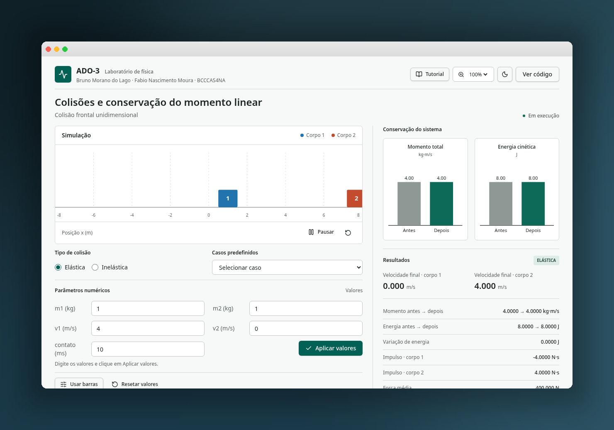

[README-ADO3.md](https://github.com/user-attachments/files/34511448/README-ADO3.md)
# ADO-3 — Colisões e Conservação do Momento Linear

> Laboratório virtual de física: simulador interativo de colisões frontais unidimensionais (elásticas e inelásticas), com análise completa de momento linear, energia cinética, impulso e força média.

**Acesse o simulador:** [https://ado-3.lovable.app](https://ado-3.lovable.app)

---

## Sobre o projeto

O ADO-3 é um laboratório virtual desenvolvido para a disciplina de Física, com o objetivo de demonstrar, de forma visual e interativa, os princípios da **conservação do momento linear** e da **energia cinética** em colisões frontais entre dois corpos.

O projeto nasceu como um programa em **Python** (com animação em matplotlib) e foi portado para a web, permitindo que qualquer pessoa utilize o simulador diretamente no navegador — **sem instalar nada, sem baixar arquivos e sem configurar ambiente**. Basta abrir o link.

## Como funciona

Dois corpos (blocos) se movem sobre um eixo horizontal unidimensional. O usuário define as massas e velocidades iniciais, e o simulador:

1. **Anima** o movimento dos corpos até o instante da colisão;
2. **Calcula** as velocidades finais usando as equações de colisão elástica ou inelástica (conforme o modo selecionado);
3. **Exibe** em tempo real os gráficos de momento total e energia cinética do sistema (antes e depois do impacto);
4. **Apresenta** um painel de resultados com todas as grandezas físicas calculadas.

### Grandezas calculadas

| Grandeza | Fórmula | Unidade |
|---|---|---|
| Energia cinética | \(K = \frac{1}{2}mv^2\) | J |
| Momento linear total | \(p = m_1v_1 + m_2v_2\) | kg·m/s |
| Velocidades finais (elástica) | \(u_1 = \frac{(m_1-m_2)v_1 + 2m_2v_2}{m_1+m_2}\) | m/s |
| Velocidade final (inelástica) | \(u = \frac{m_1v_1 + m_2v_2}{m_1+m_2}\) | m/s |
| Impulso | \(J = m\,\Delta v\) | N·s |
| Força média | \(F_m = \frac{|J|}{\Delta t}\) | N |

## Funcionalidades

- **Dois modos de colisão:** elástica (conserva energia cinética) e inelástica (corpos permanecem unidos após o impacto);
- **Casos predefinidos:** massas iguais, corpo leve contra pesado e corpo pesado contra leve;
- **Parâmetros ajustáveis:** massas (kg), velocidades (m/s) e tempo de contato (ms), por digitação ou por barras deslizantes;
- **Controle da animação:** pausar, continuar e reiniciar, com três políticas de reinício automático (ao sair da tela, após N segundos fora da tela, ou nunca);
- **Gráficos comparativos:** momento total e energia cinética antes e depois da colisão;
- **Tutorial guiado:** na primeira visita, um passo a passo de 16 etapas apresenta cada função da interface;
- **Modo claro e escuro:** alternância com um clique, com a preferência salva no navegador;
- **Ajuste de tamanho:** zoom da interface de 75% a 200%;
- **Código-fonte original:** o código Python original pode ser visualizado e copiado diretamente no site, pelo botão "Ver código".

## Tecnologias utilizadas

| Ferramenta | Papel no projeto |
|---|---|
| **Lovable** | Plataforma de desenvolvimento utilizada para construir, hospedar e publicar o site (disponível 24h, sem necessidade de servidor próprio) |
| **React + TypeScript** | Interface e lógica da simulação |
| **Tailwind CSS** | Estilização e temas (claro/escuro) |
| **SVG** | Renderização da animação e dos gráficos |
| **Python (original)** | Versão inicial do simulador, mantida como referência e disponível para consulta no próprio site |

As equações físicas foram portadas fielmente do código Python original para TypeScript, garantindo que os resultados numéricos exibidos no site sejam idênticos aos do programa original.

## Como usar

1. Acesse [https://ado-3.lovable.app](https://ado-3.lovable.app);
2. Na primeira visita, siga o **tutorial guiado** (ou pule, se preferir);
3. Escolha o **tipo de colisão** (elástica ou inelástica);
4. Defina os **parâmetros** (massas, velocidades e tempo de contato) digitando os valores ou usando as barras deslizantes;
5. Observe a **animação**, os **gráficos de conservação** e o painel de **resultados**;
6. Use os casos predefinidos para explorar cenários clássicos de colisão.

## Autores

- **Bruno Morano do Lago**
- **Fabio Nascimento Moura**

Turma: **BCCCAS4NA**

---

*Projeto acadêmico — ADO-3 · Laboratório de Física*
